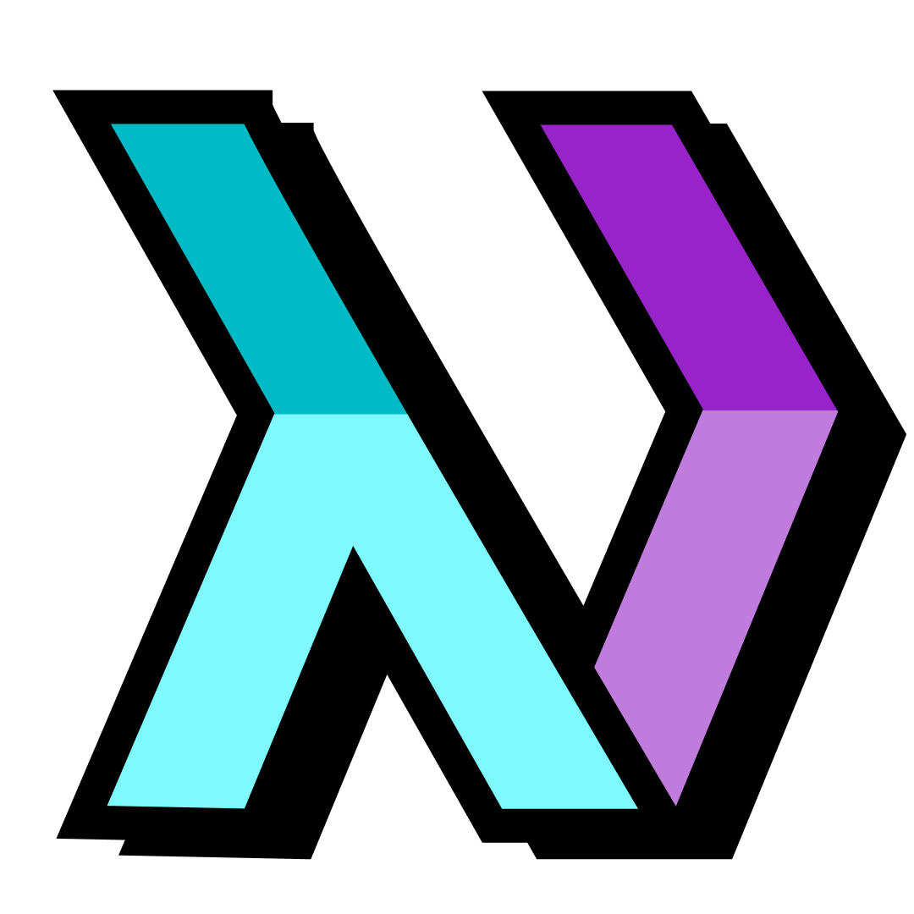

  
  <h1>NeoHaskell</h1>

NeoHaskell is a Haskell dialect and application framework focused on newcomer
friendliness and productivity. It combines Haskell's type safety with APIs and
conventions that favor clear, explicit code.

The project provides foundations for event-sourced applications, where state is
derived from a history of events. It brings together the language, reusable
libraries, integrations, and developer tooling to help people build and run
reliable applications with less incidental complexity.

NeoHaskell is under active development.
